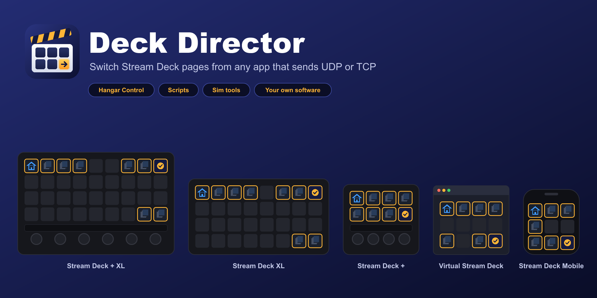

# Deck Director

Switch your Stream Deck's pages from any app that can send a UDP or TCP message: Hangar Control, a script, a home-automation system or your own software.

**[Download the latest version](https://github.com/chriskent/deck-director-releases/releases/latest)** · **[Help pages](https://chriskent.github.io/deck-director-releases/)** · **[Ask a question](https://github.com/chriskent/deck-director-releases/discussions/categories/q-a)** · **[Report a bug](https://github.com/chriskent/deck-director-releases/issues/new/choose)**

- Go to a page by name or number, or step to the next or previous page.
- Back follows a breadcrumb; Previous retraces your exact path; Home goes home.
- Choose the deck and profile in the message, or use the one showing.
- Works on your own profiles: adopt up to 50, shared across all your decks.
- Stream Deck + XL, XL, +, Virtual Stream Deck and Stream Deck Mobile. Windows, Stream Deck 7.1 or later.

## Quick start

1. Download `uk.co.mxdesign.deckdirector.streamDeckPlugin` from the latest release and double-click it.
2. Drag an **Adopt Profile** key onto your profile and press it twice.
3. Put a **Set Home Page** key on R1C1 of page 1.
4. Send `page:+1` by UDP or TCP to `127.0.0.1:41555`, or try it with Start menu › Deck Director › Send a test message.

Everything else is in the [help pages](https://chriskent.github.io/deck-director-releases/).

This repository holds the downloads and help pages only. Deck Director is free to use; see [LICENCE](LICENCE.md). Not affiliated with Elgato.
