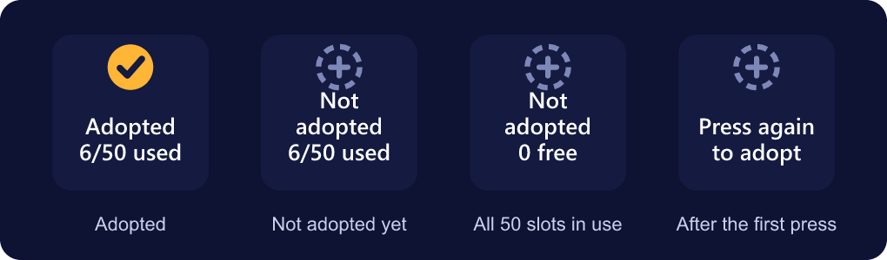

# Adopting profiles

Stream Deck only lets a plugin switch profiles that belong to it. Adopting marks one of **your** profiles as Deck Director's, so it can switch its pages.

## What adopting changes

Two fields are added to the profile's settings file. Nothing else changes: your keys, pages, names and Smart Profile (app) switching all keep working. You can go on editing the profile as normal.

Stream Deck must be closed while the file is changed, so adopting or releasing **closes and reopens Stream Deck** by itself. A backup of each changed file goes to `%LOCALAPPDATA%\DeckDirector\backups`.

{: .note }
Adoption relies on undocumented Stream Deck behaviour. It's been tested on Stream Deck 7.5.

## With the Adopt Profile key (easiest)

1. Drag **Adopt Profile** (category Deck Director) onto any page of the profile.
2. Press it twice. The second press must come within 4 seconds; the key's settings can turn that off.
3. Stream Deck closes and reopens, and the key shows **Adopted**.

Press it twice again to release the profile.

## What the key shows

The top line says whether the profile the key is on is adopted. The bottom line counts the 50 adoption slots, which are shared by all your decks:

| Key shows | Meaning |
|---|---|
| **Adopted** · 6/50 used | This profile is adopted. 6 of the 50 slots are in use across all your decks. |
| **Not adopted** · 6/50 used | Press twice to adopt this profile; it takes one of the 44 free slots. |
| **Not adopted** · 0 free | Every slot is in use. Release a profile you no longer switch to make room. |
| **Press again to adopt** | The first press. Press again within 4 seconds, or wait and nothing happens. |
| **Built in** | Deck Director's own test profile, which doesn't need adopting. |
| **Other plugin** | The profile belongs to another plugin, so it can't be adopted. |
| **Copied key** | The key was copied along with a duplicated profile. Delete it and drag in a new one. |

### The key's settings

- **Status** explains what the key shows for this profile.
- **Slots** gives the full count, e.g. *6 in use · 44 free · 50 total*.
- **Show slots in use** puts the count on the key. Untick it for a key that shows the status only.
- **Ask for a second press first** guards against an accidental press. Untick it to adopt or release with one press.

## With the adopt tool

1. Start menu › Deck Director › **Adopt a Stream Deck profile**.
2. Type the profile's number to adopt it, or `r` and its number to release it.

## Limits

Up to **50 profiles** can be adopted at once, shared across all your decks: any mix of Stream Deck + XL, XL, Stream Deck +, Virtual Stream Deck and Stream Deck Mobile. The Adopt Profile key and the adopt tool's list both show how many are in use. Releasing a profile frees its slot for another.

## Don't duplicate an adopted profile

A copy made in the Stream Deck app keeps the adoption fields, so two profiles claim the same place and Deck Director only reaches one of them. If you want a copy as a backup, release it, or don't use it for switching.

## Uninstalling

Uninstalling Deck Director leaves adopted profiles working as normal profiles, and reinstalling picks them up again. Release them first if you want them exactly as they were.
