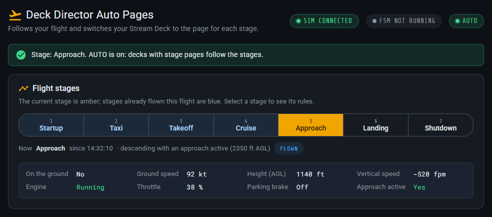
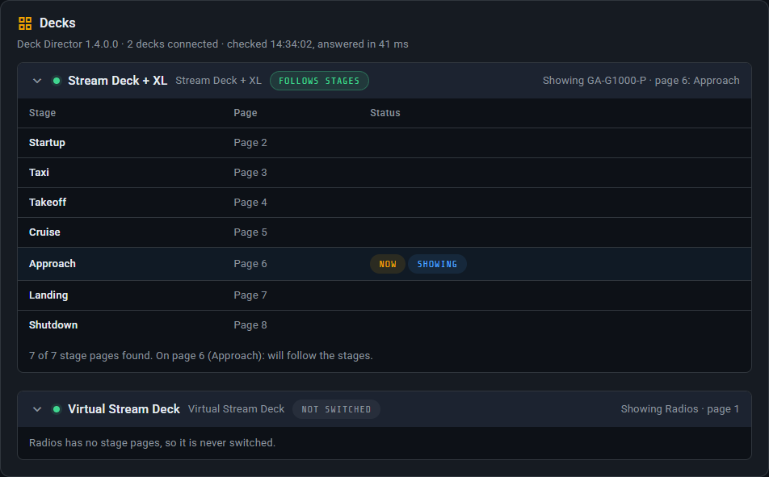
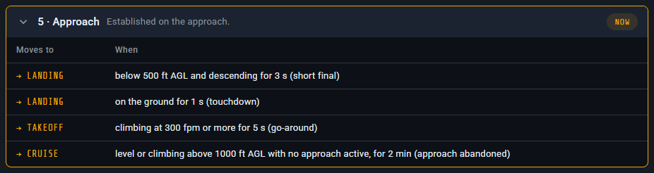
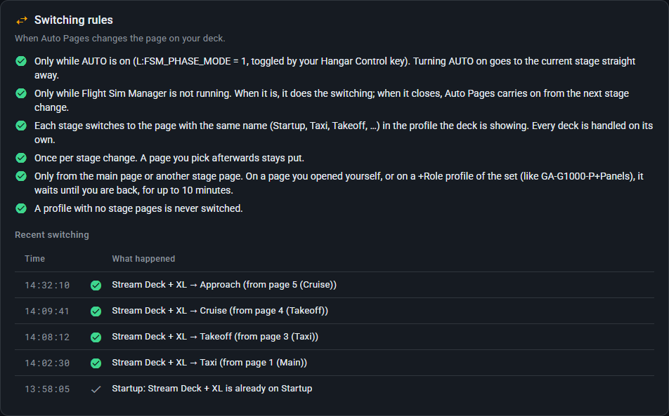
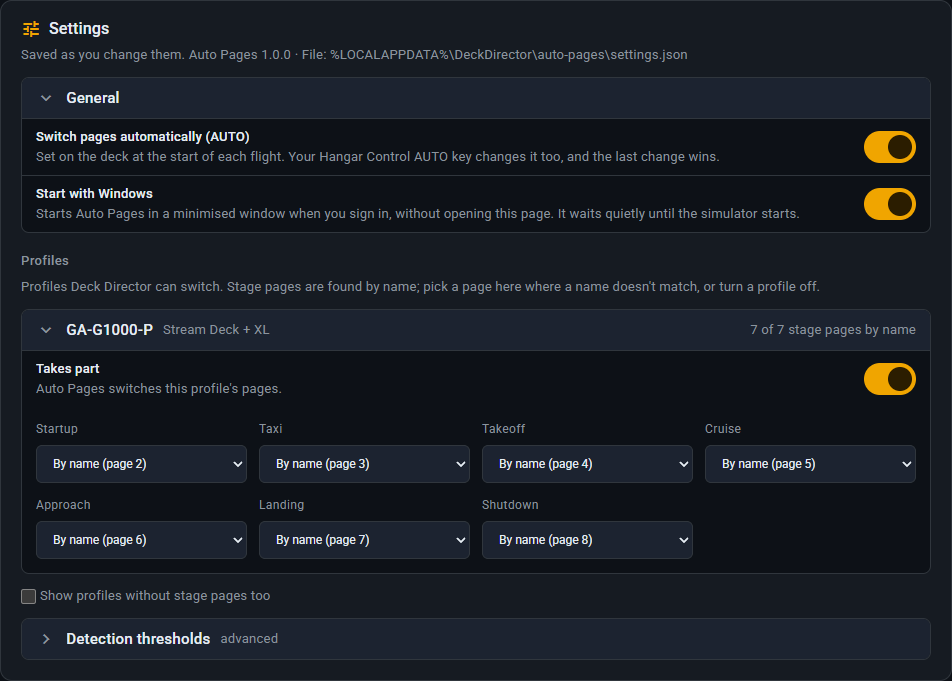

# Auto Pages

Deck Director Auto Pages follows your flight in Microsoft Flight Simulator and switches your Stream Deck to the page for each stage of the flight. It comes with Deck Director 1.4.0 and later.

## Setting it up

1. **Adopt the profile** you fly with (see [Adopting profiles](adopting.md)).
2. **Name its pages after the stages:** `Startup`, `Taxi`, `Takeoff`, `Cruise`, `Approach`, `Landing` and `Shutdown`. Case and spaces don't matter. You don't need all seven, and other pages (for example `Main` or `Radios`) are left alone. If your pages have other names, you can match them up in the settings instead.
3. **Start Auto Pages** from the Start menu: **Deck Director → Deck Director Auto Pages**. A small window opens minimised (keep it open while you fly) and its page opens in your browser.
4. **Turn AUTO on**, on the page or with a Hangar Control key (see below).

Under **Decks**, the page shows what each deck is showing and which page it found for each stage. **Now** marks the current stage's page, **Showing** the page on the deck, and **No page** a stage it couldn't find.

Auto Pages waits quietly until the simulator is running, so you can start it before the sim. To have it start every time you sign in to Windows, turn on **Start with Windows** in its settings.

## The stages

| Stage | Covers |
|---|---|
| Startup | Cold and dark until the aircraft first moves under its own power. |
| Taxi | To and from the runway, including the run-up. |
| Takeoff | The take-off roll and the initial climb, to 1000 ft above the ground or until you level off. |
| Cruise | Everything en route: climb, cruise and descent. |
| Approach | Established on the approach: low and descending, or descending with an approach active in the GPS. |
| Landing | Short final, touchdown and the rollout. |
| Shutdown | Parked after the flight. |

Every change has to hold for a few seconds, so one odd reading never moves your deck. The page lists every rule with the exact numbers in use, and shows why each change happened. Select a stage to jump to its rules:

## When it switches

- **Only while AUTO is on.** Turning AUTO on takes your deck to the current stage straight away.
- **Once per stage change.** A page you pick afterwards stays put.
- **Only from the main page or another stage page.** If you've opened another page yourself, or a `+Panels` profile of the set (for example `GA-G1000-P+Panels` beside `GA-G1000-P`), Auto Pages waits until you're back, for up to 10 minutes.
- **Each deck on its own.** A deck showing a profile with no stage pages is never switched.

The page lists these rules too, and below them every switch it has made, waited for or skipped:

## AUTO and MAN with Hangar Control

AUTO/MAN is the LVar `L:FSM_PHASE_MODE` (0 = MAN, 1 = AUTO). Your choice is set on the deck when each flight starts; after that, whichever changes it last wins: a Hangar Control key or the switch on the page.

To make a toggle key in Hangar Control, use the **SimVar / LVar** action type with the LVar `L:FSM_PHASE_MODE` and **Toggle**. Auto Pages also publishes `L:FSM_FLIGHT_PHASE` (1 Startup … 7 Shutdown, 0 when unknown) and `L:FSM_FLOWN` (1 once airborne, 0 after shutdown), for keys that light up by stage.

## Settings

On the page, under **Settings**:

- **Switch pages automatically (AUTO)**
- **Start with Windows**
- **Profiles:** turn a profile off, or choose which page each stage uses where the names don't match (or **No page** for a stage you don't want).
- **Detection thresholds (advanced):** when each stage starts. Changes apply from the next flight.

Settings are kept in `%LOCALAPPDATA%\DeckDirector\auto-pages\settings.json`, beside a log of each flight in `flights`.

## Flight Sim Manager

If Flight Sim Manager is running, Auto Pages leaves the switching to it and only watches. When Flight Sim Manager closes, Auto Pages carries on from the next stage change.

## Good to know

- It needs Deck Director 1.3.1 or later and Microsoft Flight Simulator on the same PC. It has been tested with Microsoft Flight Simulator 2024.
- The page is only reachable from your own PC (`http://127.0.0.1:41557`).
- Starting Auto Pages a second time just opens the page of the one already running.
