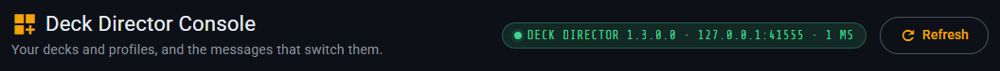
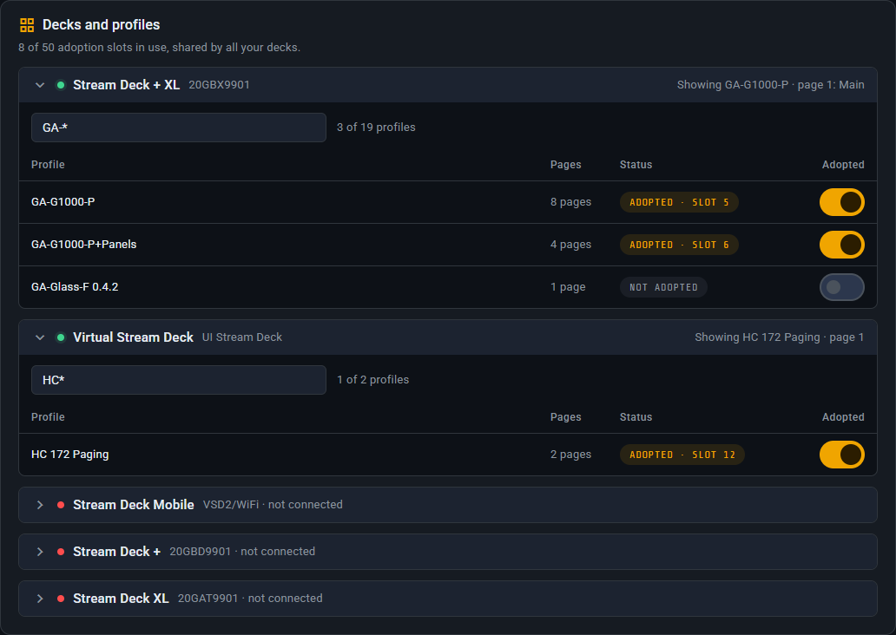
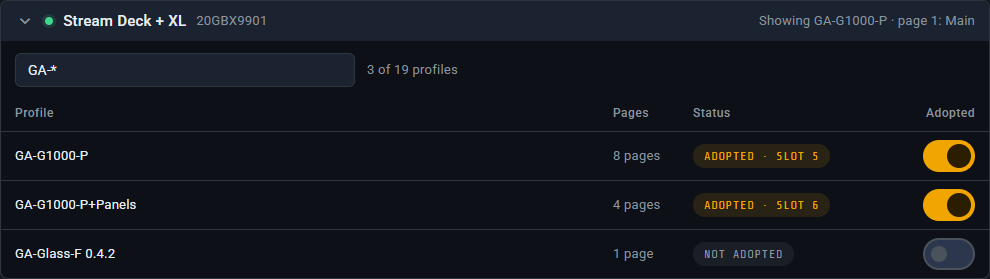
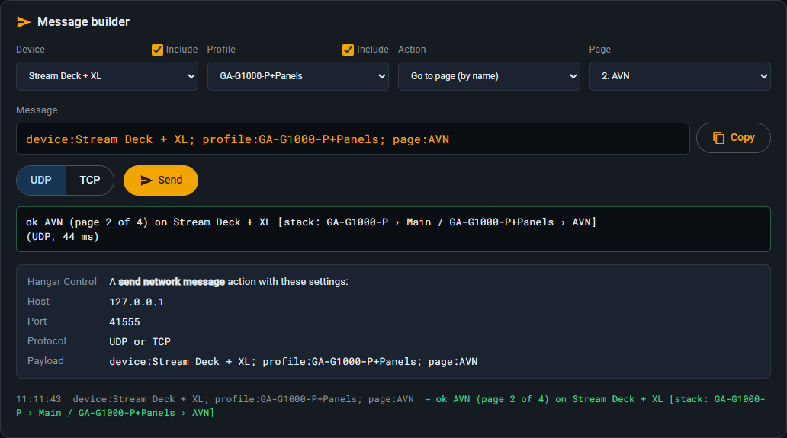
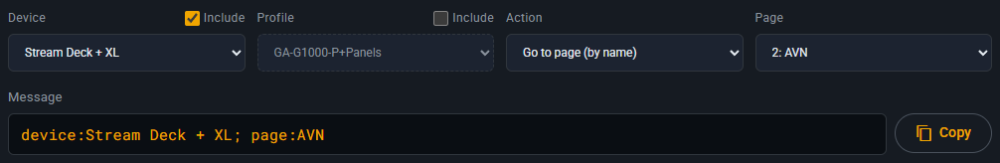

# Deck Director Console

The Deck Director Console is the easiest way to set up and check Deck Director. It's one page in your browser where you can:

- see every deck, what it's showing and its profiles,
- adopt or release a profile with one switch,
- build the exact message for a page, try it on the deck, and copy it into Hangar Control or a script.

{: .note }
The Console runs on your own PC. Nothing is sent anywhere else, and it only talks to Deck Director and Stream Deck's own files.

## Opening it

Start menu › **Deck Director** › **Deck Director Console**. It opens in your web browser at `http://127.0.0.1:41556/`.

The Console stops by itself 10 minutes after you close the page. Open it again from the Start menu whenever you need it. It's installed with Deck Director 1.2.0 or later; if it isn't in your Start menu, [update Deck Director](https://github.com/chriskent/deck-director-releases/releases/latest).

## Status

The pill at the top right shows whether Deck Director is answering:

| Pill | Meaning |
|---|---|
| Green: **Deck Director 1.3.0.0 · 127.0.0.1:41555 · 2 ms** | Deck Director is running. It shows the version, the address messages go to, and how quickly it replied. |
| Red | No reply. A message underneath says why; check Stream Deck is running with Deck Director installed. The profile lists still work, read from Stream Deck's own files. |

**Refresh** checks again and reloads the decks and profiles. If a newer Deck Director is available, a banner offers the download.

## Decks and profiles

Every deck Stream Deck knows is listed, connected or not. The line above them counts the **50 adoption slots**, shared by all your decks.

### Each deck

The heading shows, from left to right:

- **A dot:** green when the deck is connected, red when it isn't. Decks that aren't connected are folded away at the bottom; click one to open it.
- **The deck's name**, as Stream Deck calls it. This is the name to use in `device:` in a message.
- **Its model number**, such as `20GBX9901` for a Stream Deck + XL or `20GAT9902` for a newer Stream Deck XL. [Supported decks](decks) lists them all. Quote it if you report a problem with a particular deck.
- **What it's showing:** the profile and page on the deck now. *(remembered)* means Deck Director last saw it before Stream Deck or the PC restarted.

### Profiles and their status

Under each deck are its profiles, with their number of pages and a status:

| Status | Meaning |
|---|---|
| **Adopted · slot 5** | Deck Director can switch this profile. It uses adoption slot 5 of 50. |
| **Not adopted** | Turn on its switch to let Deck Director switch it. |
| **Deck Director** | Deck Director's own test profile. It works without adopting. |
| **Other plugin** | The profile belongs to another plugin, so it can't be adopted. |

### Adopting and releasing

Turn on a profile's **Adopted** switch to adopt it, or turn it off to release it. The Console asks you to confirm, then:

1. Stream Deck closes (it must be closed while the profile's file is changed),
2. two fields are added to the profile (or removed, when releasing), after saving a backup,
3. Stream Deck opens again, and the switch and status update.

It takes a few seconds. Your keys, pages and Smart Profile switching are unchanged. [Adopting profiles](adopting) explains what changes.

### Filtering a long list

Type in a deck's filter box to show only some of its profiles. The count beside it says how many are shown, such as *3 of 19 profiles*.

| Filter | Shows |
|---|---|
| `GA-*` | Profiles whose names start with GA- |
| `*C172*` | Profiles with C172 anywhere in the name |
| `C172` | The same: text without `*` or `?` matches anywhere |
| `HC ?72*` | `?` matches any one character |

Case doesn't matter. Each deck keeps its own filter, remembered in your browser.

## Message builder

The builder writes a message for you, so you don't have to remember the [message format](messages).

1. **Device:** the deck to switch.
2. **Profile:** the profile to switch to. Its pages fill the Page list.
3. **Action:** what to do, such as **Go to page (by name)**, **Next page**, **Back**, **Previous** or **Home**. **ping**, **list** and **help** are there too.
4. **Page** (or a number, for actions that need one).

The **Message** box shows the result, such as `device:Stream Deck + XL; profile:GA-G1000-P+Panels; page:AVN`.

- **Copy** puts it on the clipboard.
- **UDP** / **TCP** chooses how to send it. Deck Director answers either; use whichever your app sends.
- **Send** tries it on your deck now. Deck Director's reply appears underneath, starting `ok` or `error`, with a log of each message you've sent below.

### Leaving the device or profile out

Untick **Include** beside Device or Profile to leave it out of the message. You can still choose them, to list their profiles and pages, but the message no longer names them:

| Included | Message | Switches |
|---|---|---|
| Device and profile | `device:Stream Deck + XL; profile:GA-G1000-P+Panels; page:AVN` | That deck to that profile's AVN page, whatever it's showing |
| Device only | `device:Stream Deck + XL; page:AVN` | That deck, to AVN in the profile it's showing |
| Profile only | `profile:GA-G1000-P+Panels; page:AVN` | A connected deck of the type the profile was made for, to AVN |
| Neither | `page:AVN` | The deck last used, to AVN in the profile it's showing |

Leave the profile in when a key has to jump to another profile. Leave it out for keys that should work in whichever profile is showing, such as **Next page** or **Back**. A hint beside Send says what a left-out device or profile will mean. [Choosing the deck, profile and page](choosing) has more.

### Into Hangar Control

Under the reply, the **Hangar Control** box lists the settings for a **send network message** action: host `127.0.0.1`, port `41555`, UDP or TCP, and the payload to paste. See [Hangar Control](hangar-control).

## Other tools

The Console does everything the older Start menu tools do, and more:

- **Adopt a Stream Deck profile**: a text-only adopt tool. See [Adopting profiles](adopting#with-the-adopt-tool).
- **Send a test message**: type a message, see the reply. See [Testing and other apps](testing#the-test-tool).
