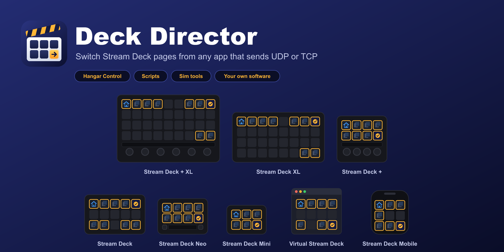
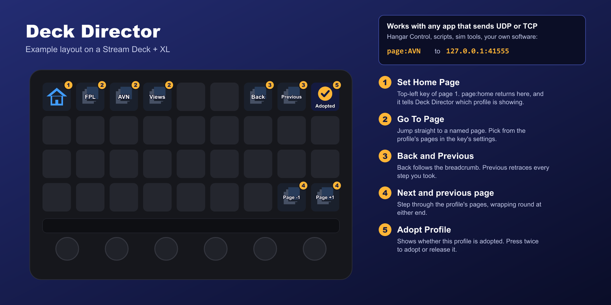
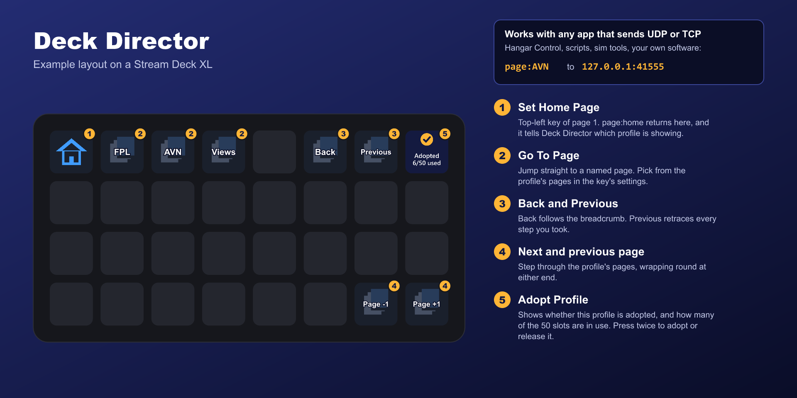
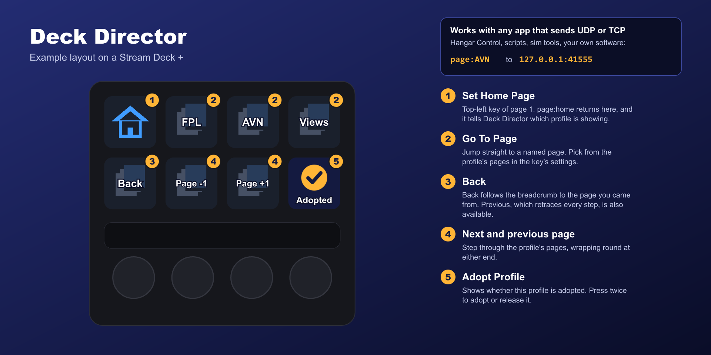
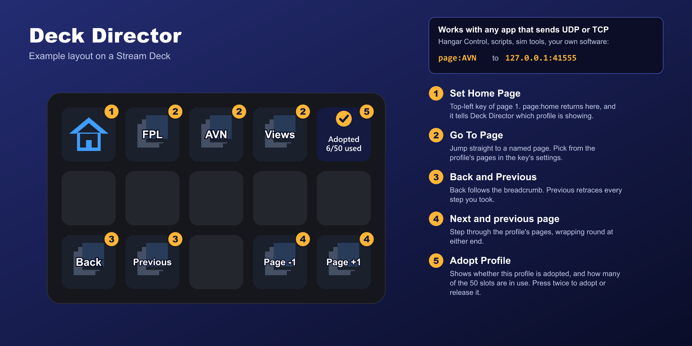
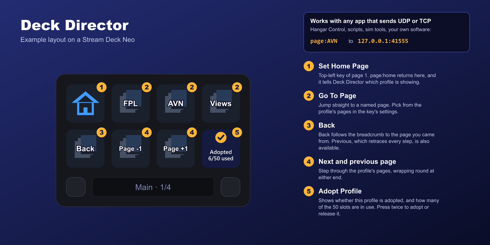
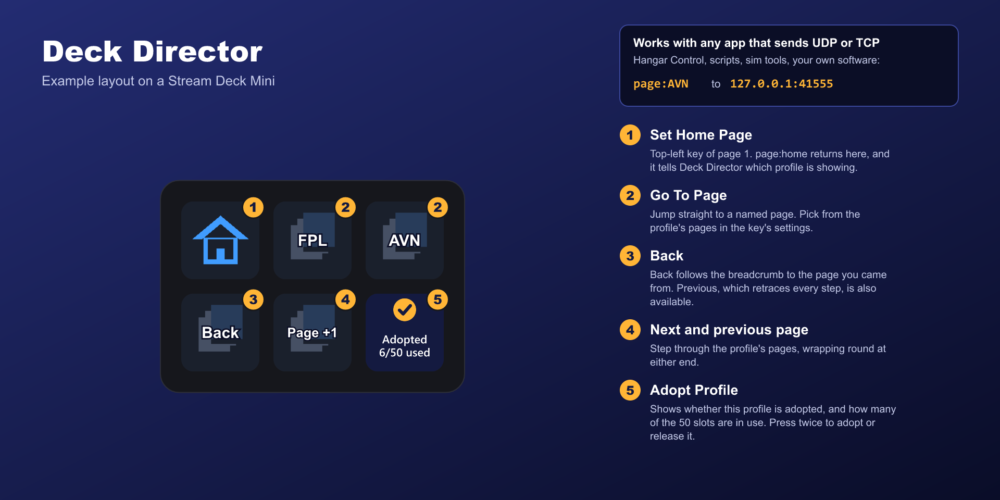

# Supported decks

Deck Director works on the Stream Deck models below, including the Virtual Stream Deck and Stream Deck Mobile. You can adopt up to 50 profiles, shared across all your decks in any mix.

Windows only, Stream Deck 7.1 or later.

## Example layouts

One way to lay out Deck Director's keys on each deck. The numbers match the notes beside each picture. Put the keys wherever suits you; only **Set Home Page** has a fixed place, on the top-left key of page 1.

### Stream Deck + XL

### Stream Deck XL

### Stream Deck +

### Stream Deck (15 keys)

### Stream Deck Neo

### Stream Deck Mini

### Virtual Stream Deck and Stream Deck Mobile

The software decks work the same way. Their size is whatever you set in Stream Deck.

## Model numbers

The [Deck Director Console](console#each-deck) shows each deck's model number beside its name. Deck Director recognises a deck by the start of that number, so every hardware revision of a supported deck works.

| Deck | Model numbers | Notes |
|---|---|---|
| Stream Deck + XL | `20GBX9901` | 36 keys, 6 dials, touch strip |
| Stream Deck XL | `20GAT9901`, `20GAT9902` | 32 keys. 9902 is the 2022 revision, and the Stream Deck Module 32 |
| Stream Deck + | `20GBD9901` | 8 keys, 4 dials, touch strip |
| Stream Deck (15 keys) | `20GAA9901`, `20GAA9902`, `20GBA9901`, `20GBL9901` | Original, 2019, MK.2 (and the 15-Key Module) and MK.2 Scissor Keys |
| Stream Deck Neo | `20GBJ9901` | 8 keys, plus 2 touch points and an info screen |
| Stream Deck Mini | `20GAI9901`, `20GAI9902` | 6 keys. Includes the Mini 2022, Mini Discord Edition and 6-Key Module |
| Virtual Stream Deck | `UI Stream Deck` | |
| Stream Deck Mobile | `VSD2/WiFi` | |

Box labels and shops show the same numbers starting `10G` instead of `20G`: a Stream Deck XL is sold as `10GAT9901`.

{: .note }
The 15-key Stream Deck, Neo and Mini were added in 1.3.0. If you use one, please say how it goes in [Discussions](https://github.com/chriskent/deck-director-releases/discussions).

## Not supported

The **Stream Deck Pedal** and **Stream Deck Studio**, and Stream Deck on Corsair keyboards, mice and controllers. A profile for one of these shows as *unsupported* in the adopt tool. If you'd like one added, [ask in Discussions](https://github.com/chriskent/deck-director-releases/discussions/categories/ideas).
