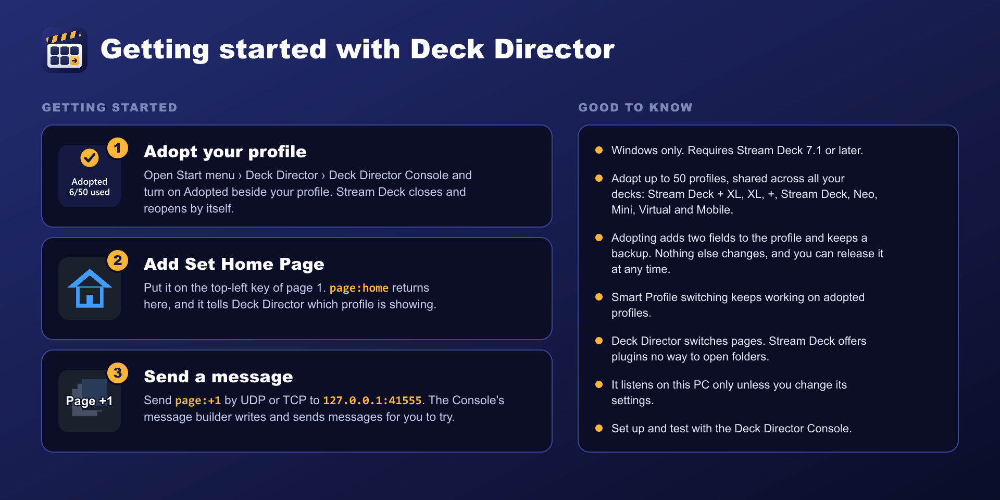
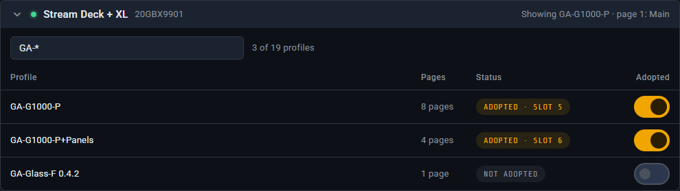
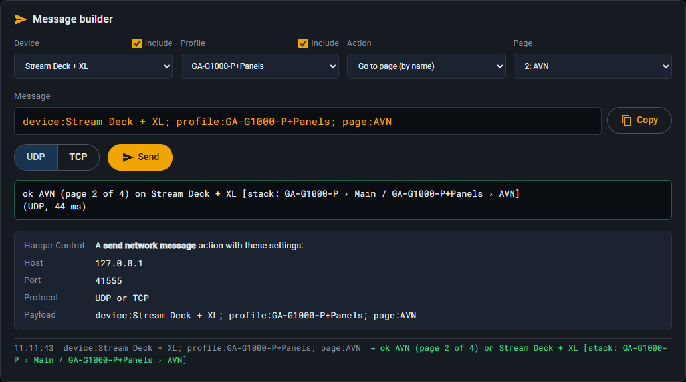

# Getting started

## 1. Install

1. Download `uk.co.mxdesign.deckdirector.streamDeckPlugin` from the [latest release](https://github.com/chriskent/deck-director-releases/releases/latest).
2. Double-click it and click **Install** in Stream Deck.

Deck Director appears in the Stream Deck app's action list under the category **Deck Director**. It also adds three tools to the Start menu, under **Deck Director**:

- **Deck Director Console**: a page in your browser showing your decks and profiles, with adopt switches and a message builder. **This is the one to start with.** See [Deck Director Console](console).
- **Adopt a Stream Deck profile**: a text-only adopt tool.
- **Send a test message**: type a message, see the reply.

It works on the Stream Deck + XL, XL, +, 15-key Stream Deck, Neo and Mini, and on the Virtual Stream Deck and Stream Deck Mobile. See [Supported decks](decks).

## 2. Adopt your profile

Stream Deck only lets a plugin switch profiles it owns. To let Deck Director switch one of yours:

1. Open Start menu › Deck Director › **Deck Director Console**.
2. Find your profile under its deck, and turn on its **Adopted** switch.
3. Confirm. Stream Deck closes and reopens by itself, and the profile shows **Adopted · slot** and a number.

You can also adopt from the deck itself, with the **Adopt Profile** key. See [Adopting profiles](adopting) for both, what adopting changes and how to undo it.

## 3. Add a Set Home Page key

Drag **Set Home Page** onto the top-left key (R1C1) of page 1. That page becomes the profile's home, and while it's showing it tells Deck Director which profile is on the deck.

## 4. Send a message

In the Console's **message builder**, choose your deck, your profile and a page, then click **Send**. The deck switches, and Deck Director's reply appears underneath, starting `ok`.

**Copy** the message into your app. Then set it up: see [Hangar Control](hangar-control) or [Testing and other apps](testing).

Messages go to **127.0.0.1, port 41555**, by UDP or TCP.
