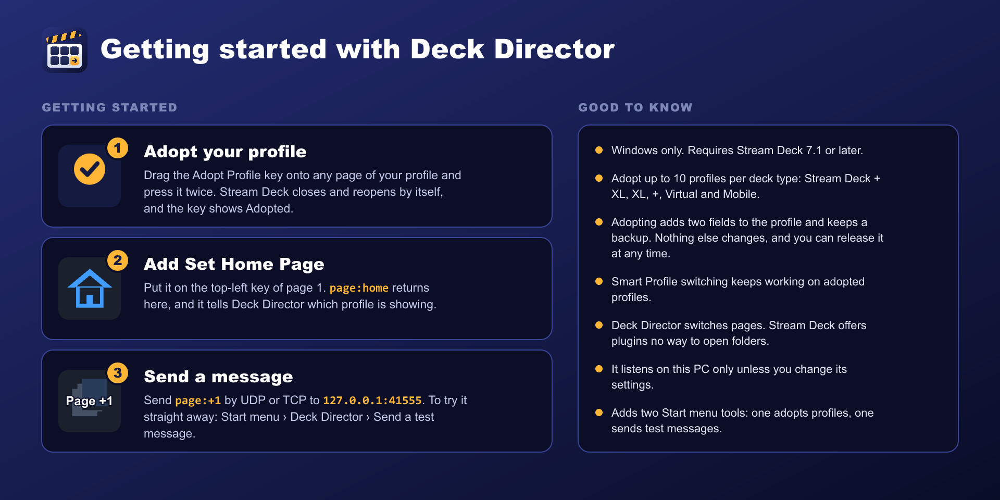

# Getting started



## 1. Install

1. Download `uk.co.mxdesign.deckdirector.streamDeckPlugin` from the [latest release](https://github.com/chriskent/deck-director-releases/releases/latest).
2. Double-click it and click **Install** in Stream Deck.

Deck Director appears in the Stream Deck app's action list under the category **Deck Director**. It also installs two helper tools to `%LOCALAPPDATA%\DeckDirector`, with Start menu entries under **Deck Director**:

- **Send a test message**: type a message, see the reply.
- **Adopt a Stream Deck profile**: the tool behind the Adopt Profile key.

## 2. Adopt your profile

Stream Deck only lets a plugin switch profiles it owns. To let Deck Director switch one of yours:

1. Drag the **Adopt Profile** key onto any page of the profile.
2. Press it twice. Stream Deck closes and reopens by itself.
3. The key now shows **Adopted**.

See [Adopting profiles](adopting) for what this changes and how to undo it.

## 3. Add a Set Home Page key

Drag **Set Home Page** onto the top-left key (R1C1) of page 1. That page becomes the profile's home, and while it's showing it tells Deck Director which profile is on the deck.

## 4. Send a message

Open **Send a test message** from the Start menu and type:

```
ping
list
page:+1
```

`ping` checks Deck Director is listening, `list` shows the profiles and pages it can switch, and `page:+1` moves to the next page. Then set up your app: see [Hangar Control](hangar-control) or [Testing and other apps](testing).

Messages go to **127.0.0.1, port 41555**, by UDP or TCP.
