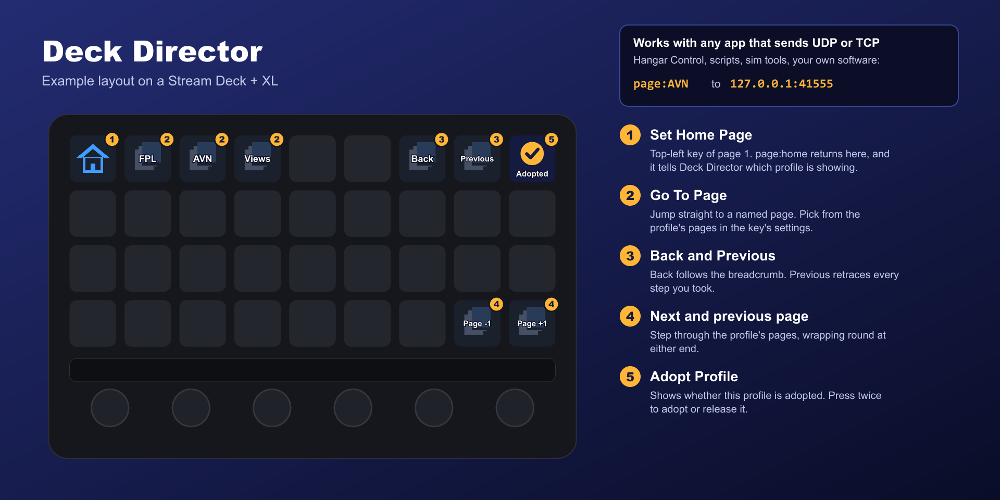

# Hangar Control

Give a Stream Deck key Hangar Control's **send network message** action:

| Setting | Value |
|---|---|
| Protocol | UDP (TCP works too) |
| Host | `127.0.0.1` |
| Port | `41555` |
| Payload | `page:AVN` (the page to go to; one key per page) |



## Handy keys

| Key | Payload |
|---|---|
| Next page | `page:+1` (wraps round) |
| Previous page | `page:-1` (wraps round) |
| Back | `page:back` (the breadcrumb: usually what you want) |
| Previous | `page:previous` (retraces every step, side trips included) |
| Home | `page:home` |

The profile must be [adopted](adopting), with a Set Home Page key on page 1. Then the payloads above work as they are. To reach a different profile, name it:

```
profile:C172 AP Panel; page:2
```

## Not working?

Every message and Deck Director's reply is written to the plugin's log, in the newest file ending `.0.log`:

```
%APPDATA%\Elgato\StreamDeck\Plugins\uk.co.mxdesign.deckdirector.sdPlugin\logs
```

A key sending `list` logs which profiles and pages Deck Director can switch. See also [Troubleshooting](troubleshooting).
