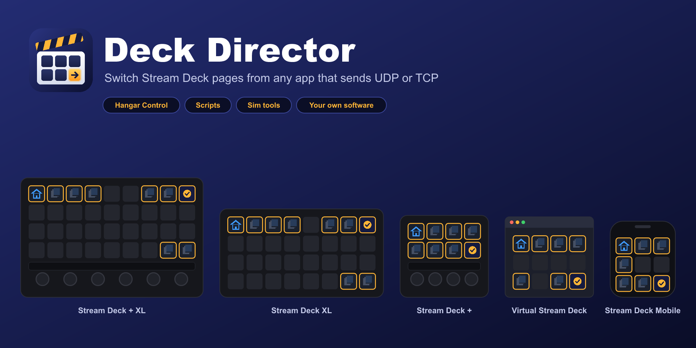

# Deck Director

Switch your Stream Deck's pages from any app that can send a UDP or TCP message: Hangar Control, a script, a home-automation system or your own software.
{: .fs-6 .fw-300 }

[Download the latest version](https://github.com/chriskent/deck-director-releases/releases/latest){: .btn .btn-primary .fs-5 .mb-4 .mb-md-0 .mr-2 }
[Getting started](getting-started){: .btn .fs-5 .mb-4 .mb-md-0 }

<video src="assets/deck-director-demo.mp4" controls muted playsinline width="100%" poster="assets/thumbnail.png"></video>

## What it does

Stream Deck can't be told to change page by another program. Deck Director listens on your PC for short messages such as `page:AVN` and switches the deck for you.

- Go to a page **by name or number**, or to the **next or previous** page, wrapping round.
- **Back** follows a breadcrumb as many levels deep as you go; **Previous** retraces your exact path.
- **Home** returns to the page with the Set Home Page key.
- Choose the **deck and profile** in the message, or let Deck Director use the one showing.
- Works on your **own profiles**: adopt up to 50, shared across all your decks.
- Every message gets a reply starting `ok` or `error`, so you can see what happened.

## Supported decks

Stream Deck + XL, Stream Deck XL, Stream Deck +, Virtual Stream Deck and Stream Deck Mobile. Windows only, Stream Deck 7.1 or later.

## Where next

| | |
|---|---|
| [Getting started](getting-started) | Install, adopt a profile, send your first message |
| [Messages](messages) | Every message Deck Director understands |
| [Choosing the deck, profile and page](choosing) | Targeting a particular deck or profile |
| [Adopting profiles](adopting) | Letting Deck Director switch your own profiles |
| [Hangar Control](hangar-control) | Setting up network message keys |
| [Testing and other apps](testing) | The test tool, PowerShell, and sending from your own software |
| [Troubleshooting](troubleshooting) | Good to know, and what to check when nothing happens |
| [Get help](support) | Ask a question, report a bug or suggest a feature |
