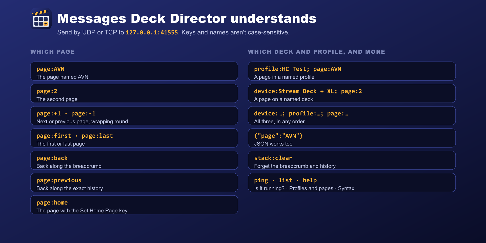

# Messages

Send each message as one UDP datagram, or one line over TCP, to **127.0.0.1:41555**. Every message gets a one-line reply starting `ok` or `error`.



## Pages

| Message | Goes to |
|---|---|
| `page:AVN` | The page named AVN (case doesn't matter) |
| `page:2` | The second page |
| `page:+1` / `page:-1` | The next / previous page, wrapping round. Any step works: `page:+2` |
| `page:first` / `page:last` | The first / last page |
| `page:back` | Back along the breadcrumb |
| `page:previous` | Back along the exact history |
| `page:home` | The page with the Set Home Page key (else where the trail started) |

## Back and previous

Deck Director keeps two trails per deck:

- **The breadcrumb** (`page:back`) is the path down to where you are. Going to a page already in it cuts it back to there, and `+1`/`-1` replace the last page rather than adding to it. Main › FPL › Approach, then back twice, gives FPL then Main.
- **The history** (`page:previous`) is every page you visited, side trips included. Main › Views › AVN › Views › FPL: back goes Views, Main; previous goes Views, AVN, Views, Main.

Both are kept when Stream Deck or the PC restarts (since 1.1.2). `stack:clear` forgets them on purpose.

## Other messages

| Message | Does |
|---|---|
| `ping` | Health check. The reply includes the version, and says if a listener failed or an update is available |
| `list` | The decks, the profiles and pages Deck Director can switch, and what each deck is showing (JSON) |
| `help` | A summary of the message syntax |
| `stack:clear` | Forgets the breadcrumb and history |

## Naming the profile and deck

Add `profile:` and `device:` to any page message, separated by `;`:

```
device:Stream Deck + XL; profile:C172 AP Panel; page:AVN
```

See [Choosing the deck, profile and page](choosing).

## JSON

The same fields work as JSON:

```json
{"device":"Stream Deck + XL","profile":"C172 AP Panel","page":"AVN"}
```

## Replies

```
ok AVN (page 3 of 4) on Stream Deck + XL [stack: MAIN / AVN]
error unknown page "AVX" (pages: 1:MAIN, 2:FPL, 3:AVN, 4:VIEWS)
```
